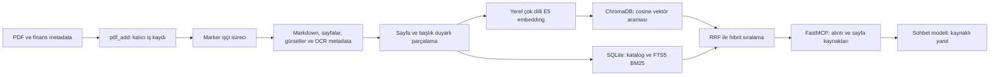

# Finance RAG MCP

Finans, risk, ekonomi ve ekonometri PDF'lerini **Marker ile Markdown'a çeviren**, sayfa
kaynaklarını koruyarak **ChromaDB'de aratan** ve **FastMCP üzerinden sunan** yerel araştırma projesi.

`pdfrag-main` araç isimleri ve katman ayrımı için referanstır; eski PyMuPDF/NLTK okuma hattı
bu uygulamaya dahil edilmez. `marker-master` indirdiğin Marker 2.0 kaynak kodudur ve
referans olarak korunur. **Aktif dönüşüm motoru Marker 1.10.1**: ayrı Python ortamında
yerel Surya/PyTorch OCR çalıştırır. `llama-server`, Ollama veya Docker gerekmez.

## Sana göre kapsam

“Quant Risk Ne Yapar” sohbetinin erişilebilen son bölümündeki BIST risk tahmini, yöntem
karşılaştırması ve Ekonometri I/II araştırma bağlamını temel alır. Kullanım alanları:

- VaR, Expected Shortfall, stres testleri, volatilite, piyasa/kredi/likidite riski literatürü.
- TCMB, BDDK, BIS, IMF gibi kurumlardan **senin eklediğin** raporlar ve düzenlemeler.
- Finansal tablolar, şirket kârlılığı/kaldıraç çalışmaları, regresyon ve model varsayımları.
- Kaynakları karşılaştırma, yöntemlerin dayanaklarını bulma ve sayfa atıflı araştırma.

MCP kaynak parçalarını verir; cevabı bağlı olduğun sohbet modeli yazar. Bu projede ayrıca
ücretli LLM API'si kullanılmaz. Canlı piyasa verisi, portföy hesaplama motoru ve otomatik
alım satım bu sürümde bulunmaz. Finans bilgisi eklediğin PDF'lerden gelir.

## Akış



## Kurulum — Windows / PowerShell

Python 3.12 önerilir. Komutları bu proje kökünde çalıştır:

```powershell
uv sync --locked --python 3.12 --extra dev
py -3.12 -m venv .marker-venv
.marker-venv/Scripts/python.exe -m pip install -r requirements-marker.lock
if (!(Test-Path .env)) { Copy-Item .env.example .env }
New-Item -ItemType Directory -Force data/inbox
uv run --no-sync finance-rag doctor
```

`uv sync` MCP, Chroma ve embedding bağımlılıklarını kurar. Marker 1.10.1, eski
Transformers/Surya bağımlılıkları nedeniyle `.marker-venv` içine ayrı kurulur.
Model ağırlıkları ilk gerçek kullanımda ayrıca indirilir; kurulum testi OCR yapıldığı anlamına gelmez.
`.env` içindeki iki dizini mutlak yola çevirmek, MCP istemcisi farklı bir çalışma
dizininden başlatıldığında verinin doğru yerde kalmasını sağlar.

`.env` içinde ayrı OCR Python'unun **mutlak yolunu** tanımla:

```dotenv
FINRAG_MARKER_PYTHON=C:/Users/musta/Desktop/rag project/.marker-venv/Scripts/python.exe
FINRAG_MARKER_DEVICE=cpu
```

Worker, model yüklemeden önce sürümü kontrol eder ve Marker 2 ile çalışmayı reddeder.
OCR kapatılmaz; dijital ve taranmış PDF'ler aynı yerel Marker hattını kullanır.
`use_llm=False`: harici LLM ile sonradan düzeltme yapılmaz. İlk gerçek dönüşümde OCR
model ağırlıkları indirilir; sunucu kurulmaması, model dosyası gerekmemesi anlamına gelmez.
`doctor` seçilen OCR Python'unun paket sürümlerini ayrıca kontrol eder.

`uv` paket indirmede sorun yaşarsa alternatif kurulum:

```powershell
py -3.12 -m venv .venv
.venv/Scripts/python.exe -m pip install -e ".[dev]"
py -3.12 -m venv .marker-venv
.marker-venv/Scripts/python.exe -m pip install -r requirements-marker.txt
.venv/Scripts/python.exe -m finance_rag.cli doctor
```

`uv.lock` ana uygulamanın bağımlılıklarını, `requirements-marker.lock` ise ayrı
Windows/Python 3.12 Marker ortamının doğrulanmış sürümlerini sabitler.
Bu bilgisayarda temiz uygulama ortamı `E:/finance-rag-runtime/app-venv` içindedir;
sistem paketlerini kullanmaz. Masaüstü profilleri bu ortama yönlendirilmiştir.
E: sürücüsündeki ortamı yeniden kurmak veya `uv run` kullanmak için önce ayarla:

```powershell
$env:UV_PROJECT_ENVIRONMENT = 'E:/finance-rag-runtime/app-venv'
$env:UV_CACHE_DIR = 'E:/finance-rag-cache/uv'
uv sync --locked --extra dev
```

Marker ayrı Python ortamında, MCP ve E5 ise `.venv` içinde çalışır.
Worker doğrudan dosya olarak çağrılır; ayrı ortamda bu projeyi kurmak gerekmez, Marker yeterlidir.

## İlk PDF

PDF'i `data/inbox` altına kopyala. Kaynak tarihi ve kurumunu biliyorsan metadata gir:

```powershell
uv run --no-sync finance-rag add "data/inbox/rapor.pdf" --metadata examples/risk-metadata.json
uv run --no-sync finance-rag search "VaR ve Expected Shortfall varsayımları nelerdir?"
uv run --no-sync finance-rag search "likidite riski" --domain risk --as-of 2024-12-31
uv run --no-sync finance-rag list
```

`examples/risk-metadata.json` **temsili** veridir; kendi belgenin bilgileriyle değiştir.
Belge tarihi bilinmiyorsa `publication_date: null` bırak. Tarih dosya adından tahmin edilmez.
`as_of` kullanıldığında tarihsiz belgeler dışlanır. Bu filtre tarihsel veri erişilebilirliğini
veya sonradan revize edilen rakamları tek başına doğrulamaz.

## MCP bağlantısı

**ChatGPT Desktop / Claude Desktop:** istemciye özel kurulum, diğer ayarları koruyan
kurulum script'i ve bağlantı kontrolü için [masaüstü entegrasyon rehberini](docs/desktop-integration.md) kullan.

`examples/mcp.json` standart stdio MCP istemci yapılandırmasıdır. `command` ve `env`
değerleri bu bilgisayardaki proje yoluna göre hazırlanmıştır; taşırsan güncelle.
`FINRAG_ENV_FILE` mutlak yolu `.env` ayarlarının istemcinin çalışma dizininden
bağımsız okunmasını sağlar. İstemcinin `env` içindeki değerleri `.env` üzerine yazılır.
İstemci bu komutla sunucuyu başlatır:

```powershell
.venv/Scripts/python.exe -m finance_rag.server
```

MCP sunucusu çalışırken aynı veri dizinini kullanan CLI işlemlerini başlatma.
Tek süreç kilidi, iki farklı sürecin katalog/vektör tutarlılığını bozmasını önler.

| Araç | İşlev |
|---|---|
| `pdf_add` | Dönüşüm ve indekslemeyi sıraya alır; hemen `job_id` döner |
| `pdf_job_status` | İşin sonucunu ve başarılıysa `document_id` değerini verir |
| `pdf_search` | Hibrit, anlamsal veya anahtar kelime araması; metadata filtreleri |
| `pdf_search_similarity` | pdfrag tarzı anlamsal arama |
| `pdf_search_keyword` | Embedding yüklemeden anahtar kelime araması |
| `pdf_list` | Sayfalı belge kataloğu |
| `pdf_get_page` | Alıntının tam sayfa Markdown bağlamını okuma |
| `pdf_remove` | Belgeyi iki arama indeksinden kaldırma |
| `pdf_health` | Bağımlılıklar, indeks sayısı ve bekleyen işler |

Araç isimleri pdfrag ile benzerdir; parametre/cevap sözleşmeleri birebir geriye uyumlu değildir.
Özellikle `pdf_add` artık iş kuyruğu kullanır; `chunk_size` cümle sayısı yerine global
token bütçesi vardır. Cevaplar yapılandırılmış JSON'dur.

Örnek MCP girdileri:

```json
{
  "pdf_path": "C:/Users/musta/Desktop/rag project/data/inbox/rapor.pdf",
  "metadata": {
    "domain": "risk",
    "title": "Belgenin gerçek başlığı",
    "publication_date": "2024-06-30",
    "institution": "Belgeyi yayımlayan kurum",
    "risk_type": "market",
    "geography": "TR",
    "language": "tr"
  }
}
```

```json
{
  "query": "VaR ile Expected Shortfall arasındaki fark nedir?",
  "top_k": 5,
  "filters": {"domain": "risk", "as_of": "2024-12-31"},
  "mode": "hybrid"
}
```

Sohbette örnek kullanım: “Bu PDF'i risk alanında ekle. İş bitince, kaynaklara göre
VaR ve ES yöntemlerini varsayımlarıyla karşılaştır; belge ve sayfa numarası ver.”
`finance_research` prompt'u ve `finance://research-rules` kaynağı atıf kurallarını da sunar.

## Dizinler

```text
src/finance_rag/
  config.py          Ortam değişkenleri ve çalışma dizinleri
  models.py          Finans metadata, filtre, sayfa ve parça şemaları
  marker_worker.py   Marker Python API'sini çağıran ayrı süreç
  conversion.py      Worker yönetimi ve gerçek sayfa sınırları doğrulaması
  chunking.py        Başlık, sayfa, tablo ve formül duyarlı parçalama
  embeddings.py      Yerel multilingual E5; query/passage önekleri
  storage.py         Kalıcı Chroma + SQLite katalog/FTS/iş kayıtları
  retrieval.py       Anlamsal ve BM25 sonuçlarını RRF ile birleştirme
  service.py         Ekleme, kuyruk, yeniden başlatma ve silme yaşam döngüsü
  server.py          FastMCP araçları, kaynak ve araştırma prompt'u
  cli.py             Terminal üzerinden kullanım
data/                Çalışma sırasında oluşturulur; Git'e alınmaz
  inbox/             İçe aktarılmasına izin verilen PDF klasörü
  chroma/            Vektör indeksi
  catalog.sqlite3    Belge/iş kataloğu ve FTS5 indeksi
  documents/<sha256>/
    source.pdf       İndekslenen dosyanın sabit kopyası
    document.md      Marker'ın sayfalı Markdown çıktısı
    document_meta.json
    conversion.json
    pages.json       Bir tabanlı fiziksel sayfa → Markdown
    manifest.json    Metadata, model ve parçalama bilgileri
    marker.log       Dönüşüm hataları ve ilerleme çıktısı
tests/               Model indirmeyen birim ve gerçek Chroma/MCP entegrasyon testleri
docs/architecture.md Tasarım kararları, sınırlar ve genişletme noktaları
```

## Doğrulama

```powershell
uv run --no-sync pytest -q
uv run --no-sync ruff check src tests
```

Testler gerçek kalıcı Chroma, gerçek SQLite FTS ve FastMCP istemcisiyle çalışır.
Ağır Marker/E5 işlemleri test çiftleriyle değiştirilir; OCR veya anlamsal arama kalitesini
bu test sayısıyla ölçmek mümkün değildir. Gerçek kabul kontrolü için dijital, taranmış,
tablo içeren ve formül içeren PDF'leri ekleyip sayfa alıntılarını kaynaklarıyla karşılaştır.
`docs/evaluation.md` kontrol setini ve açık doğrulama sınırlarını içerir.

İki sayfalık sentetik finans PDF'i ve gerçek model/MCP kabul scripti hazır:
`output/pdf/finance-risk-acceptance.pdf`, `scripts/verify_real_pdf.py`.
Script ayrı `data/acceptance` kütüphanesini kullanır. Model önbelleği ve Marker
indirme geçici dosyaları `FINRAG_MODEL_CACHE_DIR` ile başka bir diske yönlendirilebilir.
Gerçek koşumun sonucu ve sınırlamaları `docs/verification.md` içinde kayıtlıdır.

Chris Brooks kitabından seçilen altı sayfa için 20 soruluk gerçek model kabul seti:

```powershell
uv run --no-sync python scripts/verify_book_pdf.py
```

Test `data/book-acceptance` içinde çalışır. Özgün PDF'in 151, 163, 258, 450, 512 ve
800. sayfaları kullanılır; test PDF'i sayfaları ile özgün sayfaların eşlemesi
`source-map.json` içinde tutulur. Kitabın tamamı indekslenmiş değildir.
İlk hazırlık için `scripts/prepare_book_acceptance.py "kitabin-tam-yolu.pdf"`
çalıştırılabilir; kitap ve üretilen alıntı PDF'i Git'e dahil edilmez.

Model indirildikten sonra `FINRAG_EMBEDDING_LOCAL_FILES_ONLY=true` ile E5'i önbellekten
ağ erişimi olmadan yükleyebilirsin. İlk kurulumda model eksikse bu ayarı `false` tut.

## Kaynaklar

- İndirilen `pdfrag-main/README.md`, `src/pdfrag/server.py`, `LICENSE`.
- İndirilen `marker-master/marker/converters/pdf.py`, `renderers/markdown.py`, `README.md`.
- [FastMCP araçlar](https://gofastmcp.com/servers/tools) ve
  [yaşam döngüsü](https://gofastmcp.com/servers/lifespan).
- [Chroma koleksiyon ayarları](https://docs.trychroma.com/docs/collections/configure).
- [Multilingual E5 model kartı](https://huggingface.co/intfloat/multilingual-e5-base).
- [Aktif Marker 1.10.1 yerel model kodu](https://github.com/datalab-to/marker/blob/v1.10.1/marker/models.py).

Üçüncü taraf kod ve model lisansları kendi kaynaklarında kalır; bkz. `THIRD_PARTY_NOTICES.md`.
